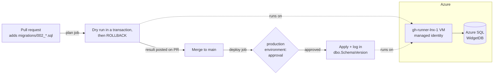

# Git for the DBA

Sample schema repo for the talk. Schema changes are numbered SQL files in
[migrations/](migrations/). A GitHub Actions workflow tests and deploys them to
Azure SQL Database from a self-hosted runner in Azure.



## How it works

| Piece | What it does |
|---|---|
| [migrations/](migrations/) | `NNN_description.sql` files, applied in name order, each exactly once. |
| [scripts/migrate.sh](scripts/migrate.sh) | `plan` runs every pending migration in one transaction and rolls it back. SQL Server DDL is transactional, so this proves the change works against the real schema without changing anything. `apply` runs each migration in its own transaction and records it in `dbo.SchemaVersion` with a checksum, the GitHub user, the commit, and a link to the run. If someone edits a migration that was already applied, both modes refuse to continue. |
| [.github/workflows/deploy-schema.yml](.github/workflows/deploy-schema.yml) | Pull request: `plan`, with the result posted as a PR comment. Merge to main: `deploy`, which waits for approval on the `production` environment. |
| Self-hosted runner `gh-runner-lnx-1` | A Linux VM in Azure. It signs in to Azure SQL with its **managed identity**, so the repo stores no database password, not even as a secret. |
| [infra/](infra/) | Terraform for the Azure SQL server and database (Entra-only auth, serverless), the runner's identity and database user, and the GitHub repo variables and `production` environment. |

Limitations of the dry run: statements that can't run inside a transaction
(`ALTER DATABASE`, full-text index DDL, and a few others) fail the plan. The
dry run also takes the same locks the real migration would, for as long as it
runs.

## Setup

Prerequisites: Terraform, [go-sqlcmd](https://github.com/microsoft/go-sqlcmd),
the Azure CLI (`az login`), the GitHub CLI (`gh auth login`), and the runner VM
`gh-runner-lnx-1` already registered with this repo.

```bash
cd infra
cp backend.hcl.example backend.hcl          # point at your state storage account
cp terraform.tfvars.example terraform.tfvars  # subscription, your UPN, your IP
export GITHUB_TOKEN="$(gh auth token)"

terraform init -backend-config=backend.hcl
terraform apply
```

`terraform apply`:

1. Turns on a system-assigned managed identity on the existing runner VM. Nothing else on the VM changes.
2. Creates the Azure SQL logical server with your account as its Entra admin, plus the serverless `WidgetDB` database.
3. Adds firewall rules for the runner's public IP and for your IP.
4. Runs `sqlcmd` locally to create a database user for the runner identity, with `db_ddladmin`, `db_datareader`, and `db_datawriter`.
5. Sets the `SQL_SERVER` and `SQL_DATABASE` repo variables. It also creates the `production` environment, which requires your approval and accepts deployments from main only.

Then apply `001` from the Actions tab (**Deploy schema > Run workflow**), or:

```bash
gh workflow run deploy-schema.yml --ref main
```

The talk track is in [demo2-actions.sh](demo2-actions.sh).

## Security notes

- This is a public repo. The `plan` job runs only for PRs from branches in
  this repo, never for forks, because a fork PR could otherwise run code on a
  runner that can reach the database. Also keep **Settings > Actions >
  General > Fork pull request workflows** set to require approval.
- The runner VM has no inbound ports open. It only makes outbound HTTPS calls
  to GitHub.
- The runner's database user can change schema and data in `WidgetDB` only.
  It is not a server admin.

## Teardown

```bash
cd infra && terraform destroy     # SQL server, database, repo variables, environment
```

The runner VM and its network aren't managed by this configuration, so
`terraform destroy` leaves them alone.
